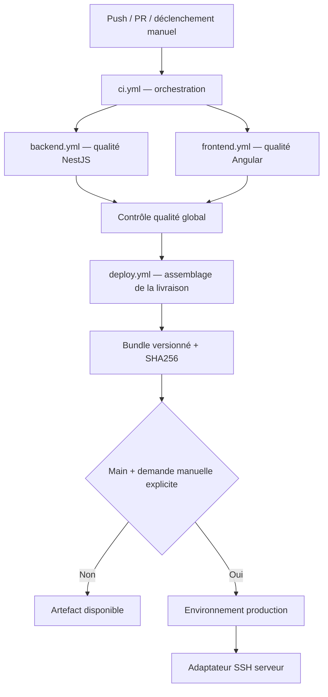

# CI/CD — DSolar-ERP

## Responsabilités des quatre workflows

- `ci.yml` est le seul déclencheur automatique. Il ne compile ni ne déploie lui-même.
- `backend.yml` exécute les contrôles historiques : Prisma, TypeScript, ESLint, Jest, Swagger, compilation, Prettier, audit npm et intégration PostgreSQL éphémère avec contrôle des privilèges SQL.
- `frontend.yml` installe via npm ci avec le lockfile versionné et npm 11.6.2, vérifie TypeScript, ESLint, Vitest, compilation Angular, Prettier et audit npm.
- `deploy.yml` assemble exclusivement les deux artefacts du même commit validé, vérifie leur présence, produit un bundle scellé par SHA256 et, uniquement sur demande explicite depuis main, appelle l'adaptateur de déploiement.

Une erreur dans l'un des deux pipelines bloque le contrôle global et l'assemblage. Les workflows réutilisables ne possèdent pas de déclencheur push autonome. Les validations ordinaires peuvent annuler une validation obsolète de la même branche ; une mise en production manuelle utilise un groupe de concurrence distinct et ne peut pas être annulée par un nouveau push. Les anciens workflows ponctuels qui modifiaient Git sont retirés ; l'historique Git les conserve. Les contrôles utilisent des permissions de lecture ; aucun commit automatique ni désactivation de tests.

## Politique de branches

- dev : développement et validation complète, aucune production.
- Pull request vers dev ou main : mêmes validations, aucun déploiement de production.
- main : livraison du commit validé, aucune publication automatique sans demande explicite.
- Actions > CI DSolar-ERP > Run workflow > main > deploy_production : true : demande de mise en production après nouvelle validation complète.

Configurer une règle de protection de main et dev dans GitHub, avec PR et statut obligatoire **Contrôle qualité global** (sélectionner le nom effectivement affiché dans les checks). Configurer l'environnement GitHub production avec reviewers requis et restriction à main ; ces protections dépendent des paramètres et de l'offre GitHub, et ne sont pas créées par YAML. Ne pas donner de secrets de production aux jobs CI.

## Artefacts

Chaque build fournit backend-<SHA> et frontend-<SHA>, conservés 14 jours. Le workflow de livraison produit dsolar-release-<SHA> (30 jours), contenant :

- COMMIT : identifiant exact de la version ;
- SHA256SUMS : sommes de contrôle ;
- backend.tar.gz : code compilé, manifests npm et schéma/migrations Prisma ;
- frontend.tar.gz : site Angular compilé.

Le bundle n'inclut ni .env ni identifiants Neon. Le serveur doit installer les dépendances du backend à partir du lockfile et générer Prisma pour son environnement cible ; les artefacts ne contiennent pas node_modules. La base PostgreSQL de CI est détruite après le job.

## Déploiement : configuration encore nécessaire

Aucun serveur de production n'a été désigné. Un adaptateur SSH est prévu pour un serveur Linux/VPS ; si un PaaS est retenu, remplacer uniquement le job production sans toucher au CI.

Dans l'environnement production, créer DEPLOY_HOST, DEPLOY_USER, DEPLOY_SSH_KEY et DEPLOY_KNOWN_HOSTS. Le compte de déploiement doit être dédié, non root, avec accès limité ; épingler la clé publique du serveur à partir d'une source de confiance, ne jamais désactiver StrictHostKeyChecking. L'adaptateur /usr/local/bin/dsolar-deploy doit être installé et administré sur le serveur, indépendamment des commits applicatifs. Il reçoit le SHA attendu en argument et le bundle sur stdin. Il doit vérifier le contenu et les sommes, refuser les chemins dangereux, préparer une version isolée, installer les dépendances verrouillées, générer Prisma, effectuer les contrôles de préproduction, activer backend et frontend ensemble et vérifier le service via /api/v1/health et une vérification réelle de disponibilité applicative. En cas d'échec, conserver/restaurer la version précédente et sortir avec un code non nul. En cas de succès, renvoyer uniquement le SHA activé sur stdout (diagnostics sur stderr).

Le serveur doit être configuré pour servir Angular et /api/v1 sous la même origine HTTPS, avec les variables d'environnement du backend fournies hors des artefacts. Les migrations de production ne sont jamais exécutées par ce pipeline : les appliquer dans une procédure distincte, après sauvegarde, revue de compatibilité et approbation, avant activation si nécessaire. Ne pas utiliser le compte propriétaire pour le runtime.

Le job production échoue si les secrets, l'adaptateur ou les contrôles manquent. Aucun hébergement n'a été modifié. Le contrôle de santé public ne suffit pas à lui seul à certifier la comptabilité ou la disponibilité de la base. Valider le déploiement complet sur un environnement de recette avant toute mise en production.
