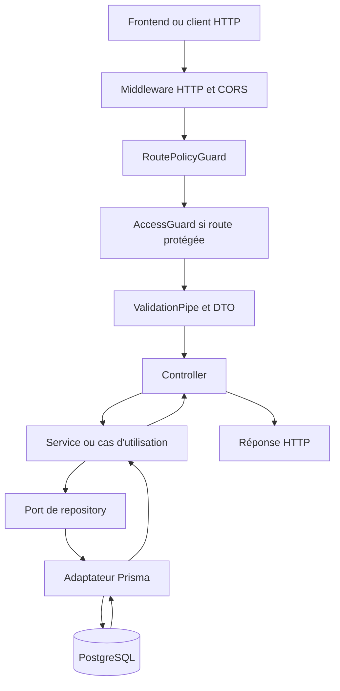

# Architecture technique du backend

## 1. Positionnement

DSolar-ERP est une API de gestion interne. NestJS 11, TypeScript strict, Prisma 6 et PostgreSQL (Neon prévu pour le déploiement) composent le backend. Node.js 22 est utilisé dans le CI. L'interface Angular est un consommateur séparé dans `frontend/`. L'API n'est pas le site marchand public.

Le backend est un **monolithe modulaire** : un seul processus NestJS et une base relationnelle, avec des frontières fonctionnelles. Il s'inspire de Clean Architecture, DDD et des ports/adaptateurs ; ce n'est pas une implémentation puriste : plusieurs services utilisent les exceptions NestJS et des invariants transactionnels résident dans les repositories Prisma. Il n'y a ni microservices, ni broker d'événements externe, ni bus distribué obligatoire.

## 2. Organisation des sources

```text
backend/
├── src/
│   ├── main.ts                  # bootstrap HTTP
│   ├── app.module.ts             # assemblage des modules
│   ├── health.controller.ts
│   ├── infrastructure/
│   │   ├── http/                # erreurs, validation, sécurité, pagination
│   │   └── prisma/              # connexion et privilèges
│   ├── modules/                 # domaines métier
│   ├── shared/                  # utilitaires transversaux
│   └── scripts/                 # commandes applicatives
├── prisma/                     # schéma et migrations SQL
├── scripts/                    # intégration, privilèges, tests de garde
├── docs/
├── package.json
└── tsconfig.json
```

Un module type possède `presentation/` (controllers, DTO), `application/` (services, ports), `domain/` (fonctions/règles métier lorsqu'elles existent), `infrastructure/` (adaptateurs de persistence), et un fichier `*.module.ts` qui lie les ports aux implémentations. Les modules ne possèdent pas tous les quatre dossiers : ne pas inventer une couche vide.

## 3. Flux d'une requête



Les guards contrôlent la déclaration de la politique, le jeton, la session et les permissions. Les pipes valident les entrées avant le handler. Les services orchestrent ; les repositories vérifient aussi les droits sur les ressources et exécutent les opérations atomiques. Le filtre global intercepte les exceptions ; l'intercepteur global ajoute les confirmations de succès. Une erreur ne doit jamais être transformée en succès.

## 4. Injection de dépendances

Un port est une interface TypeScript associée à un symbole d'injection ; le module NestJS associe ce symbole à une classe concrète via `provide` et `useClass`. Exemple réel : `COMPANY_SETTINGS` → `PrismaCompanySettingsRepository`, injecté dans `CompanySettingsService`. Un test de service remplace le port par un double sans connecter PostgreSQL. Les tests d'intégration utilisent les vrais repositories.

Références : [SettingsModule](../src/modules/settings/settings.module.ts), [port](../src/modules/settings/application/company-settings.port.ts), [service](../src/modules/settings/application/company-settings.service.ts).

## 5. Persistence et transactions

`PrismaService` centralise le client et son cycle de vie. Les lectures complexes emploient notamment RepeatableRead pour produire une page et son total cohérents ; les écritures sensibles emploient notamment Serializable, verrous SQL et contraintes d'intégrité. Le choix d'isolation est propre à chaque cas. Une transaction doit englober le changement métier et son audit lorsqu'ils sont indissociables. Les conflits de concurrence doivent être traités explicitement ; ne pas relancer aveuglément une mutation sans clé d'idempotence.

Les données monétaires utilisent Decimal en base et des chaînes décimales / BigInt dans les calculs sensibles. Le frontend ne constitue pas une autorité de calcul. Les documents émis, écritures et mouvements historiques doivent être conservés ; les corrections passent par transitions ou contrepassations.

## 6. Modules assemblés

[AppModule](../src/app.module.ts) importe ConfigModule global, PrismaModule puis 16 modules métier : Identity, Stores, Inventory, Products, Procurement, Sales, Dashboard, Audit, Treasury, Expenses, SupplierReturns, Accounting, Settings, Notifications, Media et OperationalSearch. Voir [le guide métier](02-modules.md).

## 7. Règles de développement

- Controller : transport HTTP, DTO, permission, délégation ; pas de calcul financier ni de requête Prisma directe.
- Application : orchestrer le cas d'utilisation et les validations métier ; injecter des ports.
- Domaine : fonctions déterministes et règles réutilisables lorsque possible.
- Infrastructure : requêtes, transactions, contrôle de périmètre, mapping des erreurs de persistence.
- Ajouter les tests unitaires, les scénarios PostgreSQL pour les invariants et les tests HTTP pour les contrats exposés.
- Ne pas introduire de `any`, de conversions non sûres, de secret en dur ni de logique dupliquée.
- Préserver les contrats existants et prévoir les migrations en cas de changement de schéma.

Points d'entrée : [main.ts](../src/main.ts), [app.module.ts](../src/app.module.ts), [PrismaService](../src/infrastructure/prisma/prisma.service.ts), [ESLint](../eslint.config.mjs).
