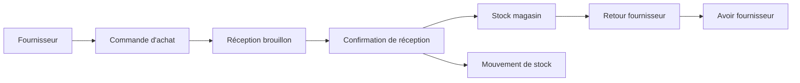
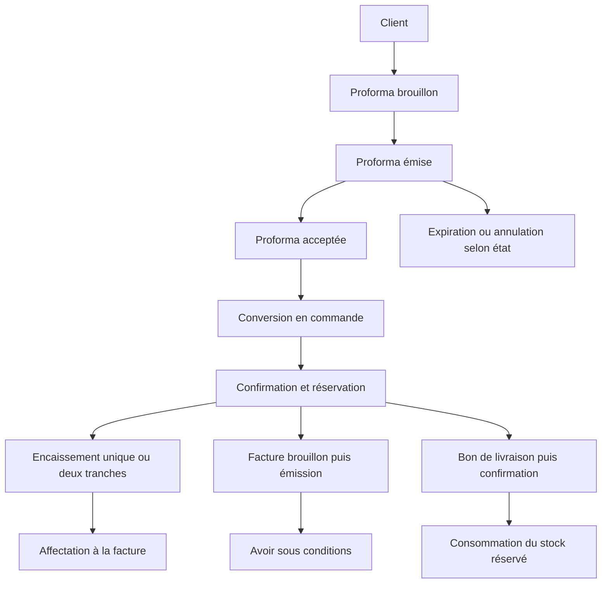
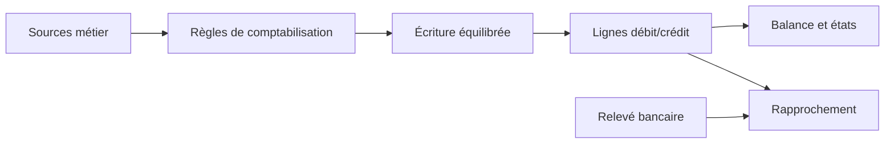

# Flux métier et règles d'intégrité

Les diagrammes décrivent les enchaînements fonctionnels, pas une autorisation de sauter une transition. Les états exacts sont dans [le schéma Prisma](../prisma/schema.prisma). Les exemples sont fictifs et les opérations doivent être exécutées via l'API.

## 1. Mise en service

1. Préparer un environnement PostgreSQL dédié et appliquer les migrations versionnées.
2. Initialiser le premier administrateur par la CLI. Le bootstrap crée les permissions et les deux rôles internes.
3. Renseigner les paramètres de l'entreprise, créer les magasins, utilisateurs et affectations.
4. Créer les catégories, marques, régimes fiscaux, produits et tarifs.
5. Configurer les caisses et, pour la comptabilité, les comptes, journaux, périodes et règles de comptabilisation.

L'initialisation n'est pas répétable sur une base contenant déjà des utilisateurs.

## 2. Stocks, magasins et achats

Le stock est individualisé par couple magasin/produit. La quantité disponible est la quantité physique moins la quantité réservée. Les écritures de stock passent par des opérations métier et leur journal, jamais par une modification libre de la quantité depuis le frontend. Une réception doit respecter la commande et les quantités restant à réceptionner. Les retours vérifient la réception d'origine, les quantités cumulées et les éventuels numéros de série. L'avoir fournisseur est une opération distincte de la sortie de stock.

Un transfert suit brouillon → approbation → expédition → réception. Les écarts à la réception sont enregistrés ; un transfert ne doit pas créer du stock par simple changement de statut. Les magasins doivent être actifs et le périmètre de l'utilisateur contrôlé. La visibilité de transfert peut concerner le magasin source ou destination ; cela ne donne pas automatiquement le droit de réaliser toutes ses transitions.

Un inventaire physique ouvre une session, enregistre les quantités comptées, puis valide les écarts. Si le stock a évolué depuis le comptage, les vérifications transactionnelles doivent empêcher d'appliquer un ajustement devenu obsolète.

Sources : [Inventory](../src/modules/inventory), [Procurement](../src/modules/procurement), [SupplierReturns](../src/modules/supplier-returns).

## 3. Parcours commercial

Ce schéma représente les relations : le code autorise plusieurs étapes après confirmation, et n'impose pas dans tous les cas une chronologie stricte acompte avant facture avant livraison. Les états de livraison et de paiement restent distincts. Ne pas afficher un document comme livré parce qu'il est payé.

### Proforma et prix

Une proforma possède des lignes (produit, magasin, quantité, prix unitaire, remise absolue et taux de TVA). Le service vérifie les lignes, le repository le périmètre de magasins et les règles de remise. Seuls les produits marqués `isSolarPlant` sont éligibles à une remise commerciale dans le flux implémenté. Une consultation ne persiste pas l'expiration ; le statut effectif est dérivé à la lecture. L'action d'expiration n'est autorisée qu'après l'échéance et est journalisée. La conversion nécessite une proforma acceptée et valide.

Le calcul commun [sales-pricing.ts](../src/modules/sales/domain/sales-pricing.ts) utilise BigInt et l'arrondi au plus proche, demi-unité vers le haut. Quantités à trois décimales, prix et remises à deux, TVA à quatre décimales (maximum 100 %). De 1 à 100 lignes. Pour une ligne :

- Net HT = arrondi à 2 décimales de quantité × prix unitaire − remise.
- TVA = arrondi à 2 décimales du net HT × taux / 100.
- TTC = net HT + TVA ; les totaux documentaires sont la somme des lignes.

Exemple : quantité 2, prix unitaire 100 FCFA, remise 10 FCFA, TVA 18 % → HT 190,00, TVA 34,20, TTC 224,20 FCFA. Il s'agit d'un exemple de calcul, pas d'une prescription fiscale. Le taux réel provient des données métier validées.

### Commande, facture et livraison

La confirmation de commande réserve le stock. La facture est dérivée de la commande et contrôlée sur ses totaux. Une facture active interdit l'annulation de la commande ; une facture émise ne se modifie pas comme un brouillon. La livraison doit respecter les quantités commandées, les livraisons déjà effectuées et les réservations. La confirmation consomme le stock dans une transaction.

Les documents PDF (proforma, facture, bon de livraison et reçu de paiement) sont générés à partir des données persistées, avec contrôle de droits. La version des paramètres de société est capturée pour préserver l'identité du document émis. Les anciennes données antérieures à cette fonctionnalité peuvent ne pas disposer d'un instantané. Les coordonnées client et libellés produit ne sont pas tous historisés.

### Paiements et avoirs

Un paiement est un enregistrement d'encaissement (pas une transaction exécutée chez Wave ou Orange Money). Moyens autorisés : CASH, BANK_TRANSFER, CHEQUE, MOBILE_MONEY, OTHER. Au maximum deux paiements actifs ; si le premier est partiel, le second doit solder la commande après avoirs. Le montant doit être positif et ne pas dépasser le solde. La clé d'idempotence est obligatoire : une répétition identique ne doit pas créer de nouvel encaissement ; une réutilisation incompatible est rejetée.

Montant net = total brut − avoirs ; reste à payer = montant net − paiements actifs. Exemple : 224,20 FCFA brut, 11,80 FCFA d'avoir, 100,00 FCFA encaissés → net 212,40 FCFA, deuxième règlement 112,40 FCFA.

Le statut brut historique `paymentStatus` peut différer de `netPaymentStatus` lorsque des avoirs existent. Utiliser le résumé pour afficher le statut net, `remaining`, `consistent`, `canRecord` et `nextPaymentMustSettle`. Ne pas dériver le solde net d'une liste de paiements partielle.

L'avoir est ventilé en lignes de facture et contrôlé par rapport au solde non encaissé et aux affectations. Un paiement affecté ou rapproché doit être régularisé suivant les règles du repository avant contrepassation. Les corrections ne sont pas des suppressions physiques.

Sources : [calcul des prix](../src/modules/sales/domain/sales-pricing.ts), [résumé des paiements](../src/modules/sales/domain/order-payment-summary.ts), [repositories commerciaux](../src/modules/sales/infrastructure).

## 4. Trésorerie et dépenses

Une caisse appartient à un magasin. Une session ouverte enregistre son solde initial, les mouvements et le solde de clôture. Les transferts de trésorerie comportent des mouvements opposés. Les opérations de rapprochement associent les règlements aux mouvements admissibles ; elles ne constituent pas un nouvel encaissement client.

Une dépense passe par les transitions de création, approbation, paiement, annulation ou remboursement selon son état. Le remboursement est tracé séparément. La caisse et les dépenses ne remplacent pas les écritures de comptabilité.

Sources : [Treasury](../src/modules/treasury), [Expenses](../src/modules/expenses).

## 5. Comptabilité et banque

Configurer comptes, journaux et périodes avant de poster. Une écriture comporte des lignes de débit/crédit, une date et une période compatible. Le total débit doit être égal au total crédit. Les montants sont exacts et non négatifs au niveau des lignes. Les écritures postées ne sont pas rééditées arbitrairement ; le mécanisme de contrepassation ajoute une opération traçable.

Sources autorisées : INVOICE, CREDIT_NOTE, CASH_TRANSFER, PAYMENT, PAYMENT_REVERSAL, EXPENSE, EXPENSE_REFUND, GOODS_RECEIPT, SUPPLIER_RETURN, CASH_MOVEMENT. Les règles déterminent les comptes et journaux. Les sources ne doivent pas être comptabilisées deux fois. Le traitement automatique dépend de la configuration de période et du worker ; il enregistre les échecs et ne signifie pas que toutes les sources sont postées immédiatement.

Une période clôturée ne reçoit pas de nouvelles écritures. Les états financiers nécessitent des classifications correctes et tiennent compte de l'état des périodes précédentes. Le rapprochement bancaire compare des lignes de relevé aux lignes comptables compatibles ; la suggestion n'est pas une validation automatique.

Sources : [Accounting](../src/modules/accounting), [types de sources](../src/modules/accounting/domain/source-types.ts).

## 6. Rapports, notifications et audit

Les créances sont agrégées par commande nette d'avoirs, sans compenser le trop-perçu d'un client avec le solde d'un autre. Les chiffres de vente, de trésorerie et de valorisation ont des bases différentes ; lire les champs `basis` et ne pas assimiler chiffre d'affaires TTC à bénéfice. Les exports CSV sont des vues de rapports. Le tableau de bord et le rapport commercial global appliquent des contrôles administrateur.

Les alertes proviennent d'événements du journal d'audit. Une notification lue par un utilisateur n'est pas lue par tous. Les événements de stock faible sont émis lors du franchissement du seuil prévu par les paramètres ; les transferts concernent les magasins autorisés. Le journal d'audit n'est pas une file de messages distribuée.

Voir [Dashboard](../src/modules/dashboard), [Notifications](../src/modules/notifications), [Audit](../src/modules/audit).
